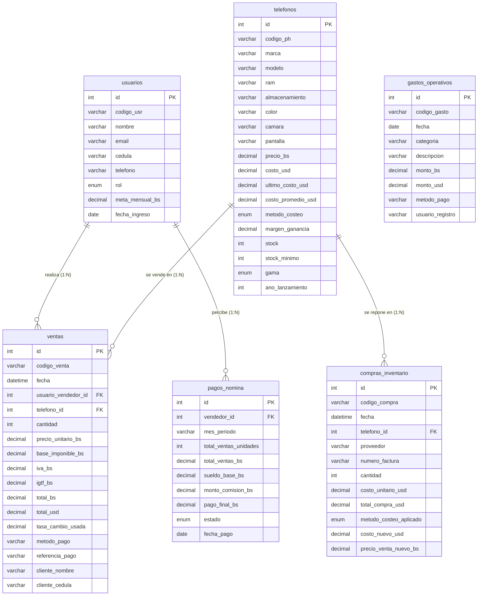

# 🏛️ Modelo Entidad - Relación (MER / DER) — TechInventario

**Sistema de Gestión Empresarial Telecom C.A.**  
**Base de Datos Relacional:** `techinventario_db` (MySQL / MariaDB)

Este documento contiene la especificación formal del **Modelo Entidad - Relación (MER)** y el **Diagrama Entidad - Relación (DER)** del sistema, diseñado conforme al estándar de **phpMyAdmin Designer**.

---

## 🖼️ Diagrama Visual (phpMyAdmin Designer)

El archivo de imagen en alta resolución se encuentra en:
* `MER_TechInventario.png` (en la raíz del proyecto y en tu carpeta de Descargas)
* `Capturas_TechInventario/03_Diagrama_MER_Base_Datos.png`

---

## 📊 Diagrama Entidad - Relación (Código Mermaid)

---

## 🔗 Relaciones y Cardinalidades del Negocio

1. **`usuarios` ──(1 : N)──▶ `ventas`**
   * **Clave Foránea:** `ventas.usuario_vendedor_id` referencia a `usuarios.id`.
   * **Descripción:** Un vendedor/administrador puede realizar múltiples ventas registradas en el sistema.

2. **`usuarios` ──(1 : N)──▶ `pagos_nomina`**
   * **Clave Foránea:** `pagos_nomina.vendedor_id` referencia a `usuarios.id`.
   * **Descripción:** Cada vendedor acumula comisiones mensuales y liquidaciones salariales en múltiples períodos.

3. **`telefonos` ──(1 : N)──▶ `ventas`**
   * **Clave Foránea:** `ventas.telefono_id` referencia a `telefonos.id`.
   * **Descripción:** Un equipo de inventario puede ser vendido en distintas facturas transaccionales.

4. **`telefonos` ──(1 : N)──▶ `compras_inventario`**
   * **Clave Foránea:** `compras_inventario.telefono_id` referencia a `telefonos.id`.
   * **Descripción:** Un teléfono puede recibir múltiples lotes de reposición de inventario con cálculo de costo promedio ponderado y último costo.
